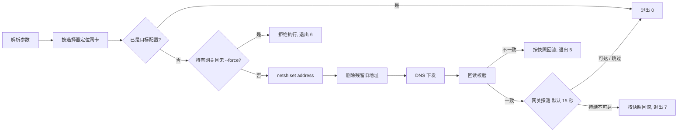

# SetIPAddress

命令行小工具：更改指定网卡的 IPv4 配置（静态地址 / 网关 / 掩码 / DNS / 切回 DHCP），重点面向 **Windows Server 2008 R2** 等老系统。

- **推荐产物：net8 NativeAOT 单文件，2.02 MB，已在 Windows Server 2008 R2 实测通过**，目标机无需安装 .NET 运行时
- 备用产物：net6 自包含单文件 8.64 MB（官方支持基线）
- 目标框架 `net8.0-windows` / `net6.0-windows`（多目标），`win-x64`
- 已嵌入 `requireAdministrator` 清单，双击/启动即请求提权
- 不依赖 WMI、PowerShell 模块，全部通过 `netsh interface ipv4` + `IP Helper` 数据回读完成

## 兼容性

| 项            | 要求                                                                                                                       |
| ------------- | -------------------------------------------------------------------------------------------------------------------------- |
| 系统          | Windows Server 2008 R2 **SP1**（x64），net6 与 net8 AOT 两种产物均已验证；Vista 及以上同代码路径                           |
| Universal CRT | KB2999226 / KB3118401，或安装 VC++ 2015-2022 x64 运行库；缺失时报 `api-ms-win-crt-runtime-l1-1-0.dll` 缺失                 |
| KB2533623     | .NET Core 3.0+ 在 Win7 内核上的加载前提，通常已随累积更新存在（net8 AOT 产物为纯原生 exe，不受该条约束）                   |
| 权限          | 管理员（清单已声明，UAC 关闭时需用管理员账户运行）                                                                         |
| 临时目录      | 仅 net6/框架依赖产物需要：单文件会解压到 `%TEMP%`；受限环境可用 `DOTNET_BUNDLE_EXTRACT_BASE_DIR` 指定目录。net8 AOT 不解包 |

net8 AOT 产物 PE 头 `Subsystem 6.0`，导入 `KERNEL32 / ADVAPI32 / bcrypt / ole32 / PSAPI / IPHLPAPI / WS2_32 + api-ms-win-crt-*`，无 Win8+ 静态导入（Win8+ API 由 YY-Thunks 降到 Vista）。net6 自包含产物另含 `OLEAUT32 / USER32 / SHELL32`。

## 构建

项目多目标：`net8.0-windows`（NativeAOT，推荐交付）与 `net6.0-windows`（备用基线）。

```powershell
# 推荐：net8 NativeAOT 单文件，输出到 dist\
dotnet publish -c Release -f net8.0-windows -p:UseAot=true -o dist -v q

# 备用：net6 自包含单文件（官方支持基线）
dotnet publish -c Release -f net6.0-windows -v q

# 可选：net8 框架依赖（需目标机已安装 .NET 8 运行时）
dotnet publish -c Release -f net8.0-windows -p:SelfContained=false -v q
```

| 产物                       | 体积        | 目标机依赖           | 实测状态             |
| -------------------------- | ----------- | -------------------- | -------------------- |
| **net8 NativeAOT**（推荐） | **2.02 MB** | 无运行时；仍需 UCRT  | **2008 R2 SP1 通过** |
| net6 自包含单文件          | 8.64 MB     | UCRT + `%TEMP%` 可写 | 2008 R2 通过         |
| net8 框架依赖              | 0.187 MB    | .NET 8 运行时        | 本机通过             |

`RuntimeIdentifier`、`SelfContained`、`PublishSingleFile`、压缩、裁剪与清单均已写入 `SetIPAddress.csproj`；AOT 通过 `-p:UseAot=true` 启用（该开关只在 net8 目标生效）。

体积优化主要靠 `PublishTrimmed=true` + `TrimMode=link`：本程序不用反射、不用动态代码、无序列化，全量裁剪安全（构建无 IL2xxx 裁剪告警）。实测体积：

| 配置                  | 体积     |
| --------------------- | -------- |
| 仅自包含单文件 + 压缩 | 31.4 MB  |
| + `TrimMode=link`     | 8.64 MB  |
| net8 NativeAOT        | 2.02 MB  |
| net8 框架依赖单文件   | 0.187 MB |

> 说明：**net6 无法做 NativeAOT**——NuGet 上 `Microsoft.DotNet.ILCompiler` 最早版本为 `7.0.0-preview.2`，`Microsoft.NETCore.App.Runtime.NativeAOT.*` 从 `9.0.0-preview.1` 才有，SDK 也以 `NETSDK1207` 拒绝 net6 AOT；AOT 仅 net8 目标可用，并用 YY-Thunks 把 Win8+ API 降到 Vista。
>
> .NET 8 的 NativeAOT 会把 `app.manifest` **自动嵌入为 RT_MANIFEST 资源**（实测），不需要链接期 `/MANIFESTINPUT`、也不依赖 Windows SDK 的 `mt.exe`。
>
> .NET 8 官方支持 Windows Server 2012 及以上，**2008 R2 属官方未支持组合**；但本项目的 net8 AOT 产物已在 2008 R2 SP1 实测通过（依赖目标机已有的 UCRT）。补丁级别变化后建议复测。

## 用法

```
SetIPAddress list [--all]
SetIPAddress show  <选择器>
SetIPAddress set   <选择器> --ip <IPv4[/前缀]> [--mask <掩码|前缀>] [--gw <IPv4|none>]
                            [--dns <IPv4[,IPv4...]|none>] [--gw-metric <0-9999>]
                            [--gw-check <秒|off>] [--force]
SetIPAddress dhcp  <选择器> [--gw-check <秒|off>] [--force]
```

### 选择器（可组合，多条件为“与”）

| 参数                | 说明                                          |
| ------------------- | --------------------------------------------- |
| `--name <连接名>`   | 例如 `"本地连接"`，需与 `list` 中“连接名”一致 |
| `--desc <关键字>`   | 网卡描述的子串，忽略大小写                    |
| `--mac <MAC>`       | `AA-BB-CC-DD-EE-FF` 或 `AA:BB:CC:DD:EE:FF`    |
| `--index <ifIndex>` | IPv4 接口索引（`list` 的“索引”列）            |

不指定选择器时，仅当**恰好有一个**“已连接”网卡才自动选中，否则要求显式指定并列出候选。

### set 参数

| 参数          | 说明                                                                             |
| ------------- | -------------------------------------------------------------------------------- |
| `--ip`        | 必填。`192.168.1.10` 或 `192.168.1.10/24`                                        |
| `--mask`      | 可选。点分掩码或前缀长度；优先级：`--ip` 前缀 > `--mask` > 网卡当前前缀 > `/24`  |
| `--gw`        | 省略 = **保持原网关不变**；填 IPv4 = 改为该网关；`none` = 删除网关               |
| `--dns`       | 省略 = 不修改；逗号分隔最多 4 个 = 覆盖设置（`register=primary`）；`none` = 清空 |
| `--gw-metric` | 网关跃点数 0-9999，仅与网关一起下发                                              |
| `--gw-check`  | 网关连通性观测窗口，默认 `15`；`0` / `off` 关闭。持续不可达则回滚                |
| `--force`     | 目标网卡当前持有网关时必需，避免误断远程连接                                     |

### 示例

```powershell
SetIPAddress.exe list
SetIPAddress.exe show --name "本地连接"

# 改地址 + 网关 + DNS（网卡原持有网关，需 --force）
SetIPAddress.exe set --name "本地连接" --ip 192.168.1.10/24 --gw 192.168.1.1 --dns 114.114.114.114,8.8.8.8 --force

# 只改地址，网关、DNS 均保持原样
SetIPAddress.exe set --name "本地连接" --ip 192.168.1.20 --mask 255.255.255.0

# 改地址并删除网关
SetIPAddress.exe set --name "本地连接" --ip 192.168.1.20/24 --gw none

# 切回 DHCP
SetIPAddress.exe dhcp --name "本地连接"
```

## 执行流程



## 退出码

| 码  | 含义                             |
| --- | -------------------------------- |
| 0   | 成功（或已是目标配置）           |
| 1   | 参数错误 / 未知命令              |
| 2   | 网卡定位失败（未命中或多命中）   |
| 3   | 权限不足（非管理员）             |
| 4   | netsh 执行失败（已尝试回滚）     |
| 5   | 回读校验失败（已回滚）           |
| 6   | 风险闸口拒绝执行（需 `--force`） |
| 7   | 网关持续不可达（已回滚）         |
| 9   | 未预期错误（打印完整异常链）     |

## 行为与限制

- **网关探活与回退**：`set` / `dhcp` 校验通过后探测生效网关，**ICMP 回显或 ARP 解析任一成功即视为可达**（避免网关屏蔽 ICMP 导致正确配置被误回退）；默认观测 15 秒，期间持续不可达则按快照回滚并退出 7。网卡未连接、未配置网关或 `--gw-check off` 时跳过。
- **成功判定只认回读**：netsh 退出码 0 不作为成功依据；重新枚举网卡比对地址/前缀/网关/DNS（DNS 按集合比对）。
- **旧地址会被清理**：`netsh set address` 只替换主地址、不删除附加地址，工具会显式 `delete address`，保证网卡最终只有目标地址。
- **回滚**：校验不匹配时按改动前快照恢复（含多地址、网关、DNS 或 DHCP）；若校验过程本身抛异常，则保留已提交配置不盲目回滚，提示人工核对。
- **网关保持**：`netsh set address` 省略 `gateway=` 会清空网关（实测），故“保持”是取当前网关回填；多网关只保留第一个，原跃点数不保留（可显式 `--gw-metric`）。
- **DHCP 标志可能滞后**：媒体断开的网卡会把静态地址存为“备用配置”，此时 `DHCP` 列仍显示“是”，地址本身已生效；工具会打印提示。
- **输出编码**：stdout 是控制台时走 `WriteConsoleW`（UTF-16），中英混排在 936 代码页下不乱码；重定向到文件时为 UTF-8，而 netsh 自身输出仍为系统 OEM 代码页。
- 仅管理 IPv4 单地址、主网关与 DNS；不做路由表、IPv6、网卡启用/禁用操作。

## 源码结构

| 文件              | 职责                                                                |
| ----------------- | ------------------------------------------------------------------- |
| `Program.cs`      | CLI 解析、命令分派、回读校验、回滚、表格输出                        |
| `Adapters.cs`     | 网卡枚举/快照/选择器匹配（`System.Net.NetworkInformation`）         |
| `GatewayProbe.cs` | 网关探活：`Ping` + `SendARP`，任一可达即通过                        |
| `Netsh.cs`        | `netsh interface ipv4` 调用封装（不重定向子进程输出，避免解码问题） |
| `ConsoleIo.cs`    | 控制台写出（`WriteConsoleW`）、管理员检测（`TokenElevation`）       |
| `app.manifest`    | `requireAdministrator` + 支持的 OS 列表                             |
